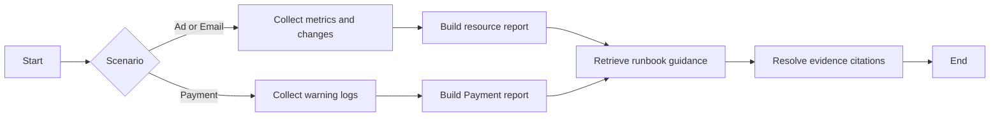

# LangGraph state and routing

The replay graph receives a scenario name and a capture directory. A conditional edge routes Payment to the log collector and resource scenarios to the metrics and change collector. A node returns a state update. The next node reads the collected records and writes the report.

The validation node checks every observation and hypothesis. Each claim needs at least one cited ID, and each ID must refer to one evidence record. A successful check establishes that readers can locate the records. Evaluating the meaning of the claim requires comparing it with those records.

The graph runs synchronously on frozen captures. Its state lives for the duration of the invocation. A checkpoint can persist the state between steps so a worker can continue an interrupted investigation using the same thread ID.

## Practice

Read [the graph implementation](../opspilot/replay.py). Follow the Payment branch from the scenario input through collection, reporting, and validation. Use `REPLAY_GRAPH.get_graph().draw_mermaid()` in Python to compare the compiled graph with the diagram above. Run `uv run opspilot eval` after changing a node and identify which outputs the evaluation covers.
