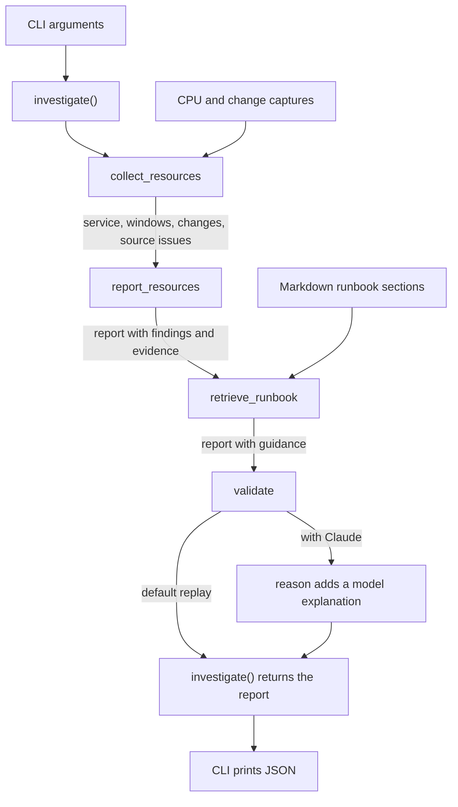

# Replay module walkthrough

Follow `ad-high-cpu` from the saved telemetry files to the final JSON report. The replay compares normal Ad CPU usage with the spike, checks which changes line up with it, and attaches troubleshooting guidance.

## Run the example

From the directory containing `pyproject.toml`:

```bash
uv run opspilot replay ad-high-cpu > /tmp/opspilot-ad-report.json
```

The CLI prints the report to standard output. The shell's `>` saves that output to the file. Use `--format markdown` to read the report as a troubleshooting summary.

## Follow the data



This diagram follows the resource branch. The [full replay graph](langraph-diagram.md) also shows the Payment branch.

### 1. Start the investigation

[`investigate()`](../../../opspilot/replay.py#L552) starts the graph with the following state for a plain Ad replay:

```python
{
    "scenario": "ad-high-cpu",
    "captures": "testbed/scenarios",
    "with_claude": False,
    "as_of": None,
}
```

The scenario routes the graph to `collect_resources`, which calls `collect_resource_evidence()`. Each node returns a state update. LangGraph applies the returned keys and carries the other fields forward. For example, the collector returns four keys, while the next node also receives the original `scenario` and `captures` values.

### 2. Collect CPU and change evidence

[`collect_resource_evidence()`](../../../opspilot/replay.py#L83) uses the scenario to look up the service `ad` and the metric `cpu_percent`. It reads the following files from the capture directory.

| Input | What the collector gets from it |
|---|---|
| [`ad-stats-baseline.csv`](../../../testbed/scenarios/ad-stats-baseline.csv) | Timestamped CPU readings from normal operation. |
| [`ad-stats-fault.csv`](../../../testbed/scenarios/ad-stats-fault.csv) | Timestamped CPU readings during the spike. |
| `ad-prometheus.json` | An alternative saved metric capture. When present, the collector uses it in place of the two CSVs. |
| [`ad-changes.csv`](../../../testbed/scenarios/ad-changes.csv) | Optional change records. The demo records the interval when `adHighCpu` was enabled. |
| `ad-rollouts.csv` | Optional deployment rollout records. |

[`summarize_capture()`](../../../opspilot/evidence/metrics.py#L11) parses the CSV readings and produces one summary per variant. Each summary contains its time span, number of readings, mean, peak, and evidence ID. [`read_changes()`](../../../opspilot/evidence/changes.py#L10) builds the structured change records. The `origin` field in the demo change record points to the experiment notes, [`ad-high-cpu.md`](../../../testbed/scenarios/ad-high-cpu.md). Replay reads the timing from the CSV.

| Window | Samples | Mean CPU | Peak CPU |
|---|---:|---:|---:|
| Baseline | 19 | 0.74% | 2.17% |
| Fault | 62 | 398.00% | 402.70% |

The node returns `service`, `windows`, `changes`, and `source_issues` to the graph.

### 3. Build the report

[`report_resources()`](../../../opspilot/replay.py#L219) reads the collected windows and changes and returns `{"report": report}`.

| Report field | How it is built |
|---|---|
| `scenario`, `service` | Copied from the graph state. |
| `observations` | Compares the baseline mean with each fault mean. [`correlate_changes()`](../../../opspilot/evidence/changes.py#L63) adds an observation when a documented change interval fits between two adjacent windows. |
| `hypotheses` | [`rank_resource_hypotheses()`](../../../opspilot/hypotheses.py#L6) checks whether every fault window's mean exceeds the baseline peak, then looks for changes that line up with the first fault window. |
| `hypothesis` | Holds the selected hypothesis. In this replay it is the first entry in `hypotheses`, the low-confidence explanation involving `adHighCpu`. |
| `limitation` | Explains that request traces and latency are needed to assess user impact. |
| `evidence` | Combines the window summaries and change records into one list. |

The last baseline reading was at **14:30:19 UTC** and the first fault reading was at **14:31:25 UTC**. The flag change was documented within that interval. That timing makes it a possible contributor and gives the engineer a specific change to verify.

### 4. Add troubleshooting guidance

The `retrieve_runbook` node calls [`attach_runbook()`](../../../opspilot/replay.py#L444). It uses three inputs:

- **The previous node's report** supplies the service and scenario for the search. Its observations, hypotheses, and evidence carry forward.
- **The shared graph state** supplies the capture directory and any source issues. When logs are available, the first message contributes up to 300 characters to the symptom.
- **The Markdown files in the sibling `runbooks` directory** supply searchable headings and excerpts, plus the filename and line number for each section.

[`retrieve_runbooks()`](../../../opspilot/evidence/runbooks.py#L45) searches the sections and returns at most one match. Keyword search is the default. Hybrid search adds a semantic ranking and combines the two lists with Reciprocal Rank Fusion. See [hybrid search](../../20-hybrid-runbook-search.md#how-opspilot-combines-the-rankings).

For this replay, it selects **“Investigate sustained Ad CPU”** from [`ad-cpu.md`](../../../testbed/runbooks/ad-cpu.md#L3). The node adds the section to `evidence` and adds a `guidance` entry whose statement is the heading and whose citation points to that section's evidence ID.

If there is no match, `guidance` is empty. With `--as-of`, the node records the cutoff and skips runbook lookup. Recorded source issues add `coverage: "partial"` and a `source_issues` list.

### 5. Validate and print

[`validate_report()`](../../../opspilot/replay.py#L478) checks for duplicate evidence IDs and verifies that each observation, hypothesis, and guidance entry cites at least one existing evidence record. The check confirms that the citations resolve. Engineers can follow the citations to judge the findings against the underlying data.

The default replay finishes after validation. With `--with-claude`, `reason()` adds a `model_explanation`. The graph keeps the report under `state["report"]`, and `investigate()` returns that inner dictionary to [the CLI](../../../opspilot/cli.py#L140).

## Read the final JSON

The JSON below shows the report layout with abbreviated lists. `null` marks a placeholder.

```json
{
  "scenario": "ad-high-cpu",
  "service": "ad",
  "observations": [
    {
      "statement": null,
      "evidence_ids": ["ev_ad_baseline_all", "ev_ad_fault_all"]
    }
  ],
  "hypothesis": {
    "rank": 1,
    "cause": {"kind": "feature_flag", "name": "adHighCpu"},
    "confidence": "low",
    "statement": null,
    "evidence_ids": ["ev_ad_baseline_all", "ev_change_ad_2", "ev_ad_fault_all"],
    "recommended_check": null
  },
  "hypotheses": [
    {"rank": 1, "cause": {"kind": "feature_flag", "name": "adHighCpu"}},
    {"rank": 2, "cause": null}
  ],
  "limitation": null,
  "evidence": [
    {"id": "ev_ad_baseline_all", "phase": "baseline", "mean": 0.74},
    {"id": "ev_ad_fault_all", "phase": "fault", "mean": 398.0},
    {"id": "ev_change_ad_2", "kind": "feature_flag", "name": "adHighCpu"},
    {"id": "ev_runbook_example", "type": "runbook", "source": "ad-cpu.md"}
  ],
  "guidance": [
    {
      "statement": "Investigate sustained Ad CPU",
      "evidence_ids": ["ev_runbook_example"]
    }
  ]
}
```

Each full hypothesis includes a statement, confidence, evidence IDs, and a recommended check. The full report also includes the change-timing observation. The runbook ID is generated from the section's source, line, heading, and text. To trace any claim, take an ID from its `evidence_ids` and find the matching object in `evidence`.

## Follow one run in VS Code

| Breakpoint | What to inspect in the Debug Console |
|---|---|
| Start of `collect_resource_evidence()` | `state` to see the CLI inputs. |
| Start of `report_resources()` | `state["windows"]` and `state["changes"]` to see the collector's output. |
| Start of `attach_runbook()` | `len(state["report"]["evidence"])` should be **3** for the bundled capture. |
| Start of `validate_report()` | The evidence count should now be **4**. Check `state["report"]["guidance"]` to see which new record it cites. |
| Before the CLI prints | Inspect `report` to see the dictionary that becomes the terminal JSON. |
