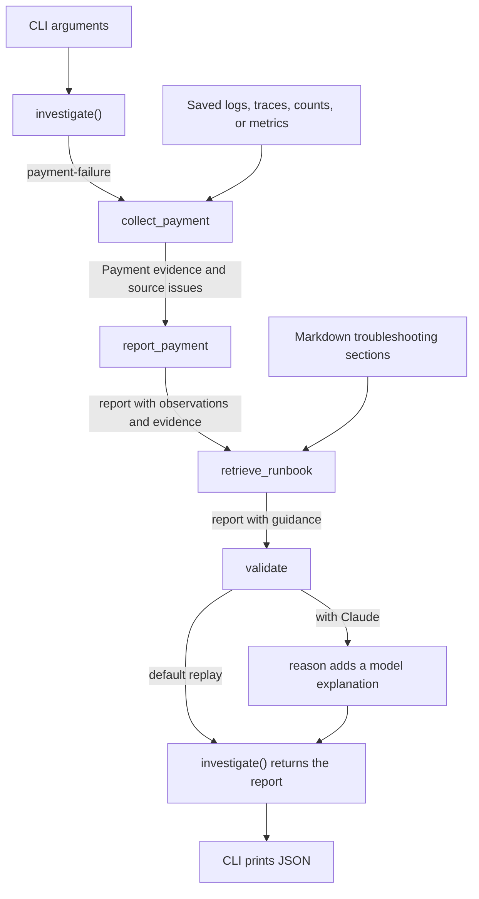

# Payment replay module walkthrough

Follow `payment-failure` from a saved Payment warning to the final JSON report. The bundled example captures one invalid-token warning. With a richer capture, the same workflow can also report failed spans, correlate logs with traces, and summarize failure rates.

## Run the example

From the directory containing `pyproject.toml`:

```bash
uv run opspilot replay payment-failure > /tmp/opspilot-payment-report.json
```

The shell saves the CLI's JSON output to the file. Add `--format markdown` and omit the redirection to read the report in your terminal.

## Follow the data



Both Payment and Ad use the same runbook, validation, and output steps. See the [full replay graph](langraph-diagram.md) and the [Ad CPU walkthrough](replay-ad-module.md).

### 1. Start the investigation

[`investigate()`](../../../opspilot/replay.py#L552) starts with the following graph state:

```python
{
    "scenario": "payment-failure",
    "captures": "testbed/scenarios",
    "with_claude": False,
    "as_of": None,
}
```

[`evidence_route()`](../../../opspilot/replay.py#L443) returns `"payment"`, which LangGraph maps to `collect_payment`. That node runs `collect_payment_logs()`.

### 2. Collect Payment evidence

Despite its name, [`collect_payment_logs()`](../../../opspilot/replay.py#L149) looks for four kinds of evidence in the capture directory. A custom replay needs at least one of these files.

| Capture file | Field added to graph state | What the reader extracts |
|---|---|---|
| [`payment-logs.jsonl`](../../../testbed/scenarios/payment-logs.jsonl) | `logs` | Groups Payment warnings and errors by severity and message. Each group records a count and references to the original rows. |
| `payment-traces.json` | `trace_errors` | Failed Payment spans and their trace details, including a parent service when available. |
| `payment-requests.json` | `request_counts` | Failed and total requests for captured client batches, plus the calculated failure percentage. |
| `payment-prometheus.json` | `failure_rates` | Summaries of sampled Payment failure rates for the available windows. |

The bundled capture supplies only the log file. [`summarize_logs()`](../../../opspilot/evidence/logs.py#L13) creates one `log_cluster` record with severity `warn`, message **“Payment request failed. Invalid token.”**, and count `1`. The record includes the original row's line, timestamp, and origin. The other evidence lists are empty.

The collector returns those four lists along with `service: "payment"` and `source_issues`. LangGraph applies those keys and carries the CLI inputs forward. Optional sources can be absent. A recorded collection failure, unreadable file, or invalid capture can add a source issue.

### 3. Build the Payment report

[`report_payment()`](../../../opspilot/replay.py#L398) turns each available evidence type into observations that cite its ID.

| Evidence | Observation the node can add |
|---|---|
| Log cluster | How many captured log records had a given severity. |
| Failed span | Which Payment operation reported an error and which service called it, if known. |
| Correlated log and span | A link between a warning and a failed operation when their captured identifiers match. |
| Client batch counts | How many of the sampled requests failed and the percentage of that batch. |
| Prometheus rates | The mean of the sampled failure-rate values for a window. |

In the bundled run, the only observation is **“Captured 1 payment log record(s) at warn level.”** One warning tells the engineer what was recorded. A failure rate requires a denominator, and a root-cause diagnosis requires corroborating evidence. The node sets `hypothesis` to `null` and `hypotheses` to an empty list. It returns `{"report": report}` to LangGraph.

### 4. Add troubleshooting guidance

[`attach_runbook()`](../../../opspilot/replay.py#L444) reads the service and scenario from the report and adds up to 300 characters from the first captured log message to the search symptom. [`retrieve_runbooks()`](../../../opspilot/evidence/runbooks.py#L45) searches the Markdown sections in the sibling `runbooks` directory. The default keyword query is:

```text
"payment" AND ("failed" OR "failure" OR "invalid" OR "request" OR "token")
```

The match is **“Investigate Payment failures”** in [`payment-failures.md`](../../../testbed/runbooks/payment-failures.md#L3). It suggests comparing Payment and Checkout logs, tracing the failing charge call, reviewing changes, and measuring the failure rate. The node appends the selected section to `evidence` and creates a `guidance` entry that cites it.

With no match, guidance is empty. With `--as-of`, the node records the cutoff and skips runbook lookup. If source issues were recorded, it includes them and marks coverage as `partial`.

### 5. Validate and print

[`validate_report()`](../../../opspilot/replay.py#L478) checks that evidence IDs are unique and that report citations resolve. The default graph ends after validation. The optional `reason` step adds a model explanation with `--with-claude`. Finally, `investigate()` extracts the inner report from graph state and [the CLI](../../../opspilot/cli.py#L148) prints it.

## Read the final JSON

The evidence IDs and records are shortened here. In the full report, the log evidence includes the original row reference, and the runbook evidence includes the section's line, excerpt, and query.

```json
{
  "scenario": "payment-failure",
  "service": "payment",
  "observations": [
    {
      "statement": "Captured 1 payment log record(s) at warn level.",
      "evidence_ids": ["ev_log_example"]
    }
  ],
  "hypothesis": null,
  "hypotheses": [],
  "limitation": "Failure rates require total request counts. Attributing cause requires corroborating evidence.",
  "evidence": [
    {
      "id": "ev_log_example",
      "type": "log_cluster",
      "source": "payment-logs.jsonl",
      "severity": "warn",
      "message": "Payment request failed. Invalid token.",
      "count": 1
    },
    {
      "id": "ev_runbook_example",
      "type": "runbook",
      "source": "payment-failures.md",
      "heading": "Investigate Payment failures"
    }
  ],
  "guidance": [
    {
      "statement": "Investigate Payment failures",
      "evidence_ids": ["ev_runbook_example"]
    }
  ]
}
```

Follow the observation's ID to the captured warning. Follow the guidance ID to the recommended troubleshooting steps.

## Follow one run in VS Code

Set the CLI Replay launch arguments to `["replay", "payment-failure"]`. For the bundled keyword example above, leave hybrid search disabled for the debug run.

| Breakpoint | What to inspect in the Debug Console |
|---|---|
| Start of `collect_payment_logs()` | `state["scenario"]` and `state["captures"]`. |
| Start of `report_payment()` | `state["logs"][0]` for the warning and `state["trace_errors"]` for the empty trace list. |
| Start of `attach_runbook()` | `len(state["report"]["evidence"])` should be **1**. |
| Start of `validate_report()` | The evidence count should be **2**. Inspect `state["report"]["guidance"]` to see the citation. |
| Before the CLI prints | Inspect `report` to see the dictionary serialized as JSON. |
